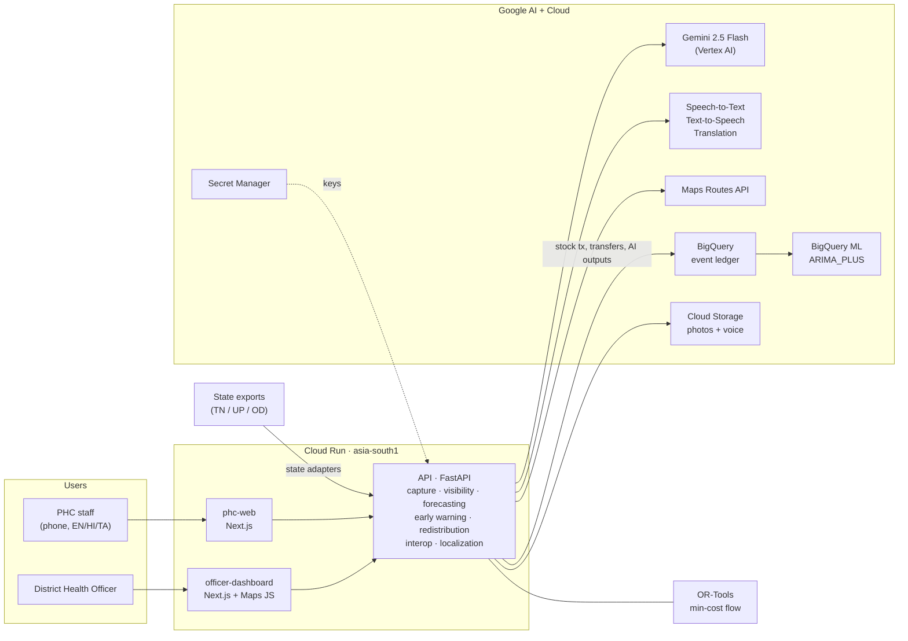

# PHC Pulse: Federated Health Resource & Supply Chain Intelligence

**PHC Pulse lets a Primary Health Centre nurse report medicine stock in seconds, by voice in Tamil or Hindi or by
photographing the paper register, and turns those reports into days of cover, stock-out forecasts and optimised
transfers between facilities that the District Health Officer approves in one click.** A canonical data model with
per-state adapters lets any Indian state join without rebuilding the platform. It runs on Gemini, OR-Tools, Maps,
Speech, BigQuery and Cloud Run.

Build with AI (Google) hackathon, Track 3. Full spec: [docs/PRD.md](docs/PRD.md) · Submission pack:
[docs/SUBMISSION.md](docs/SUBMISSION.md) · Pitch deck: [PPTX](docs/pitch/PHC_Pulse_Spontom_Pitch.pptx) / [PDF](docs/pitch/PHC_Pulse_Spontom_Pitch.pdf)

## Live demo (Cloud Run, asia-south1)

| What | URL |
|---|---|
| PHC Staff app (mobile first, EN / HI / TA) | https://health-resource-network-phc-web-847963771142.asia-south1.run.app |
| District Health Officer dashboard | https://health-resource-network-officer-dashboard-847963771142.asia-south1.run.app |
| API (OpenAPI docs at `/docs`) | https://health-resource-network-api-847963771142.asia-south1.run.app/docs |

All data is **synthetic** and labelled that way in the data and the UI. `POST /api/demo/reset` restores the starting
state between demo runs. The badge at the top right of each app shows which Google integrations are live.

## Core journey (PRD §57 Priority 1)

```text
Stock report (voice / register photo / text / form)                 PHC Staff app
 ↓  Speech-to-Text → Gemini extraction → staff confirmation (EN / HI / TA, spoken back with Text-to-Speech)
Days of cover + beds + staff + Facility Readiness score
 ↓
Forecast (8 weeks, low / expected / high) + stock-out risk + possible surge signal
 ↓
Redistribution: OR-Tools min-cost flow on Routes API travel times, with a Gemini explanation
 ↓
District Health Officer approves → both facilities notified → dispatched → received    DHO dashboard
```

**Headline score:** Facility Readiness = stock cover 40 · beds 20 · staff 20 · reporting freshness 10 · surge
stability 10 (weights configurable per state in `data/adapters/<state>.json`).
**Roles:** PHC Staff (`apps/phc-web`) and District Health Officer (`apps/officer-dashboard`).
**Demo states:** Tamil Nadu / Madurai (post-flood diarrhoea), Uttar Pradesh / Gorakhpur (vector-borne season),
Odisha / Koraput (malaria).

## Architecture



The API holds the demo state in memory (generated at start-up from a fixed seed) and mirrors every stock
transaction, transfer and AI output to BigQuery. Each Google integration sits behind a small adapter with a labelled
fallback, so the journey never breaks when a service is slow or unavailable.

## Google AI integration map (PRD §54)

| Google technology | Role in PHC Pulse | Where | Live in production |
|---|---|---|---|
| Gemini 2.5 Flash on Vertex AI | Stock extraction from voice/text with medicine matching, never inventing quantities; schema-validated JSON | `services/api/app/capture/`, `ai/prompts/extract_stock_v1.md` | Yes |
| Gemini multimodal | Reads the handwritten register photo and flags illegible cells and unknown medicines | `ai/prompts/extract_register_v1.md` | Yes |
| Gemini | Explains each optimiser transfer in the officer's language (cannot change quantities) | `app/redistribution/explain.py` | Yes |
| Cloud Speech-to-Text | Tamil / Hindi / English voice stock reports | `app/integrations/cloud_language.py` | Yes |
| Cloud Text-to-Speech | Plays the confirmation back to staff | same | Yes |
| Cloud Translation | Translates free text (UI strings are pre-translated) | same | Yes |
| Google OR-Tools | Min-cost-flow redistribution that respects donor safety stock | `app/redistribution/optimizer.py` | Yes (library) |
| Maps Routes API | Real drive times between facilities for the optimiser | `app/integrations/routes.py` | Yes |
| Maps JavaScript API | DHO facility map with readiness, surges and transfer routes | `apps/officer-dashboard/src/components/facility-map.tsx` | Yes; OpenStreetMap fallback if the key is rejected |
| BigQuery | Append-only ledger of stock transactions, transfers and AI outputs; canonical facility + consumption tables | `infrastructure/bigquery/schema.sql` | Yes |
| BigQuery ML (ARIMA_PLUS) | Shared weekly demand model across states (1,536 facility × medicine series), shown as the challenger to the serving baseline | `infrastructure/bigquery/forecast_model.sql` | Trained; serve with `FORECAST_BACKEND=bigquery` |
| Cloud Storage | Keeps the original register photos and voice recordings | `app/integrations/cloud_sinks.py` | Yes |
| Cloud Run + Secret Manager | Three services; server keys come from Secret Manager | `infrastructure/cloud-run/deploy.sh` | Yes |
| Firebase / Firestore | Real-time notifications and auth | `app/integrations/cloud_sinks.py` | Not yet: in-app notifications (Firestore database not created) |

## Run locally

Prerequisites: Node 22+, pnpm 11, Python 3.12 with [uv](https://docs.astral.sh/uv/).

```bash
cp .env.example .env                                  # every key is optional: each has a labelled demo fallback
for a in apps/*; do cp $a/.env.example $a/.env.local; done
pnpm install
(cd services/api && uv sync)

pnpm dev:api                  # http://localhost:8030  (OpenAPI docs at /docs)
pnpm dev:phc-web              # http://localhost:3030  PHC Staff
pnpm dev:officer-dashboard    # http://localhost:3031  District Health Officer
```

Optional BigQuery set-up (tables, synthetic history, shared BQML model):

```bash
python data/generator/synth.py --out data/generated
cd services/api && uv run python ../../data/transformations/load_bigquery.py --all
```

Checks: `pnpm test:api` (pytest), `pnpm lint`, `pnpm build`,
`(cd services/api && uv run python -m scripts.eval_extraction)` (golden extraction set; uses Gemini when configured).

## Configuration

API (`.env` locally; Cloud Run env vars and Secret Manager in production):

| Variable | Purpose | Without it |
|---|---|---|
| `GOOGLE_GENAI_USE_VERTEXAI` + `GOOGLE_CLOUD_PROJECT` | Gemini on Vertex AI using the service account (production default) | Rule-based parser + labelled fixtures |
| `GEMINI_API_KEY` | Gemini via AI Studio key (alternative to Vertex) | as above |
| `GEMINI_MODEL`, `GEMINI_LOCATION`, `GEMINI_THINKING_BUDGET` | Model (`gemini-2.5-flash`), Vertex endpoint (`global`), thinking budget for text tasks | defaults shown |
| `GOOGLE_CLOUD_API_KEY` | Speech-to-Text, Text-to-Speech, Translation | Browser Web Speech transcript or scripted transcript; browser speech synthesis |
| `MAPS_API_KEY` | Routes API travel times | Haversine distance × 1.35 at 35 km/h |
| `BIGQUERY_DATASET` (+ ADC) | BigQuery event ledger | In-memory only |
| `FORECAST_BACKEND` | `baseline` (default) or `bigquery` (serve BQML ARIMA_PLUS) | Local seasonal baseline |
| `GCS_BUCKET` (+ ADC) | Keep capture photos / recordings | Media processed in memory, not kept |
| `FIREBASE_PROJECT_ID` (+ ADC) | Firestore notifications | In-app notifications |
| `GOOGLE_APPLICATION_CREDENTIALS` | Service-account key path, **local only** (Cloud Run uses its service account) | Application Default Credentials |
| `CORS_ORIGINS`, `CORS_ORIGIN_REGEX` | Allowed browser origins | localhost:3030/3031 |
| `FORCE_DEMO_MODE` | Force every fallback even with keys (tests always do) | `false` |
| `DATA_SEED`, `DEMO_REFERENCE_TIME` | Deterministic synthetic data | seed 20260930, now |

Apps (`apps/*/.env.local`; baked in at build time): `NEXT_PUBLIC_API_URL`, `NEXT_PUBLIC_MAPS_API_KEY` (browser key,
HTTP-referrer restricted; the dashboard falls back to OpenStreetMap without it).

## Demo mode vs real integrations

Every integration is wrapped in an adapter. **Setting the env var is the only step needed to turn it on**, and the
API then *verifies* it: at start-up each configured integration is probed (a Routes call, a Translation/TTS call, a
Gemini model lookup, the BigQuery tables, the bucket, the Firestore database). Only integrations that pass show as
**live** in the badge; a key that is set but failing shows as demo with the reason. `GET /api/system/modes` returns
the same list (`?refresh=true` re-probes). Every AI result carries `model_name`, `model_version`, `prompt_version`
and `mode` (`gemini`, `demo` or `demo_fallback`), and the UI marks anything produced by a fallback.

## Adding Gemini API key / Firebase later

- **Gemini API key:** production already uses Gemini through Vertex AI with the service account. When the lead
  creates the secret (`gcloud secrets create gemini-api-key --data-file=-`), re-run
  `infrastructure/cloud-run/deploy.sh api`: the script attaches `GEMINI_API_KEY=gemini-api-key:latest`
  automatically. It keeps Vertex AI unless you deploy with `GEMINI_BACKEND=apikey`.
- **Firestore:** create the `(default)` Firestore database, then deploy with `FIREBASE_PROJECT_ID=<project>`.

## Deploy

```bash
infrastructure/cloud-run/deploy.sh                 # api + phc-web + officer-dashboard
infrastructure/cloud-run/deploy.sh --local api     # build the same image with local Docker
```

The script stages a minimal build context per service in a temp directory and runs `gcloud run deploy --source`.
Cloud Run URLs are deterministic, so the API gets CORS for both apps and the apps get `NEXT_PUBLIC_API_URL`
before anything exists. The browser Maps key is written to a generated `.env.production` inside the temp build
context only, so it is never committed. Server keys come from Secret Manager (`maps-api-key`, `google-api-key`).
The API runs as one warm instance because the demo store is in memory; BigQuery is the durable mirror.

## State onboarding (PRD §40)

Tamil Nadu, Uttar Pradesh and Odisha each export stock in their own format (different field names, drug codes,
timestamp formats and units). Onboarding a state is a configuration file, not a code change:

1. **Register the state:** `data/adapters/<state>.json` → `config` (languages, season focus, readiness weights,
   cross-district transfer policy, forecast model to use).
2. **Map the export:** the same file's `adapter` block maps native fields, drug codes, timestamp format and unit
   factors to the canonical schema (`data/schemas/canonical_v1.json`).
3. **Validate:** `POST /api/states/<id>/ingest` returns accepted canonical records and per-record errors; the
   dashboard's *Interoperability & models* tab shows a native record next to its canonical form.
4. **Share the model:** the state points `forecast_model` at the shared model; the model card reports accuracy per
   state against naive baselines. Only models and aggregate metrics are shared, never facility-level data.

A fourth state (or a neighbouring country with a different drug-code list) needs a new adapter file and a medicine
code map; the capture, forecasting, early-warning, optimiser and dashboard code does not change.

## AI safety (PRD §35)

Gemini gets structured context and must return schema-validated JSON (`ai/schemas/`, prompts in `ai/prompts/*_v1.md`).
Unknown drug codes are rejected. Quantities are never invented (null when not stated), and staff confirm every
extraction before the ledger changes. The optimiser decides quantities, not Gemini, and the explanation cannot alter
them. Donors never go below safety stock. Surge alerts are *possible signals* that the DHO verifies before
facilities see them. Every transfer needs DHO approval. No patient-level data is stored.

## Layout

| Path | Purpose |
|---|---|
| `apps/phc-web/` | PHC Staff app (EN/HI/TA; voice, photo, text and form capture) |
| `apps/officer-dashboard/` | DHO dashboard (map, warnings, transfer review, emergency scenario, interoperability) |
| `services/api/app/` | FastAPI: `capture/`, `visibility/`, `forecasting/`, `early_warning/`, `redistribution/`, `interop/`, `localization/`, `integrations/` (Google adapters), `store.py`, `routers/` |
| `ai/` | Versioned prompts, JSON schemas, extraction golden set |
| `data/` | Synthetic generator, state adapters, canonical schema, committed sample, BigQuery loader |
| `infrastructure/` | Cloud Run deploy script, BigQuery schema + BQML model |

## Known gaps

- Demo auth: the role comes from an `X-Role` header set by each app. Production would use Firebase Auth custom claims.
- The in-memory store resets when the API restarts. BigQuery mirrors events but is not yet the read path.
- Forecasts are trained on synthetic history only, without weather or surveillance features.
- Firestore real-time notifications and offline sync (PRD Priority 4) are not live.
